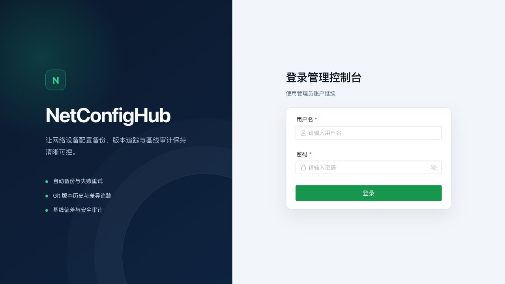
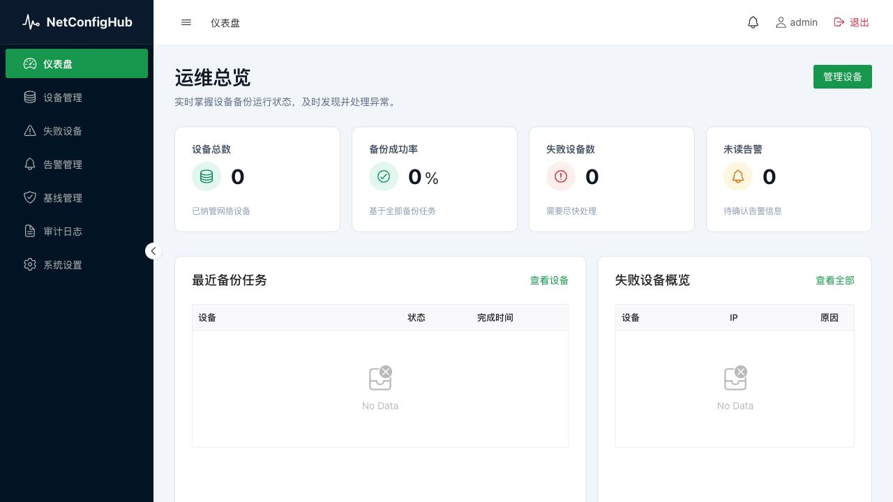
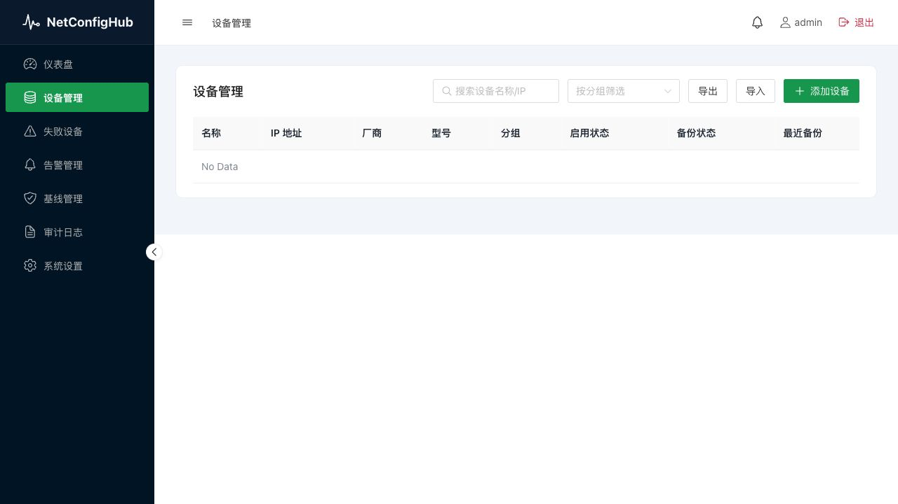

# NetConfigHub

中文 | [English](README.md)

NetConfigHub 是面向中小型网络运维团队的网络设备配置备份与管理平台。它包含 Go 后端、内嵌 Vue Web UI、REST API、手动/定时备份任务、Git 配置版本管理、基线比对、告警、Hook、审计日志和 API Token 访问能力。

## 功能

- 设备新增、编辑、删除、启用/禁用、分组、导入和导出。
- 支持 Cisco、Huawei、H3C、Ruijie 风格设备的 SSH/Telnet 采集框架。
- 手动和定时备份任务，支持重试。
- Git 存储设备配置，提供历史和 Diff API。
- 基线管理和偏差报告。
- 告警、Webhook、失败设备、审计日志和系统配置 API。
- Go 单二进制内嵌 Web UI。
- 默认 SQLite，支持 MySQL 配置。
- 提供 Docker Compose 和 systemd 部署示例。

## Demo 截图

### 登录页



### 运维总览



### 设备管理



## 快速开始

构建并运行单二进制：

```bash
go build -o netconfighub ./cmd/api
./netconfighub
```

Web UI 已内嵌进二进制。存在 `configs/config.yaml` 时读取该文件，否则使用
`./data` 下的开发默认配置启动。

打开：

```text
http://localhost:8080
```

默认管理员账号：

```text
username: admin
password: admin
```

生产环境不要使用默认账号密码。

## Linux 单文件部署

从 GitHub Releases 下载 `v0.1.2` Linux 压缩包，或自行构建：

```bash
make release-bundle VERSION=v0.1.2
```

运行时只需要可执行文件，Web UI 和默认配置均已包含：

```bash
tar -xzf netconfighub-v0.1.2-linux-amd64.tar.gz
cd netconfighub-v0.1.2-linux-amd64

export NCH_ENV=production
export NCH_DATA_DIR="$PWD/data"
export NCH_ADMIN_PASSWORD='替换为强密码'
export NCH_JWT_SECRET="$(openssl rand -hex 32)"
export NCH_ENCRYPTION_KEY="$(openssl rand -hex 32)"
export NCH_CORS_ALLOWED_ORIGINS='https://nch.example.com'
./netconfighub
```

生产模式会拒绝弱密钥、缺少初始管理员密码或 CORS 使用 `*` 的配置。

## systemd 服务

安装并启用：

```bash
sudo useradd --system --home /var/lib/netconfighub --shell /usr/sbin/nologin nch || true
sudo install -d -o nch -g nch /opt/netconfighub /etc/netconfighub /var/lib/netconfighub
sudo install -m 0755 netconfighub /opt/netconfighub/netconfighub

sudo tee /etc/netconfighub/netconfighub.env >/dev/null <<'EOF'
NCH_ADMIN_USERNAME=admin
NCH_ADMIN_PASSWORD=替换为强密码
NCH_JWT_SECRET=替换为至少32位随机字符串
NCH_ENCRYPTION_KEY=替换为至少32位随机字符串
NCH_CORS_ALLOWED_ORIGINS=https://nch.example.com
EOF
sudo chmod 0600 /etc/netconfighub/netconfighub.env

sudo cp deploy/netconfighub.service /etc/systemd/system/netconfighub.service
sudo systemctl daemon-reload
sudo systemctl enable --now netconfighub
sudo systemctl status netconfighub
journalctl -u netconfighub -f
```

## Docker

先创建 `.env`：

```bash
cat > .env <<'EOF'
NCH_ADMIN_PASSWORD=替换为强密码
NCH_JWT_SECRET=替换为至少32位随机字符串
NCH_ENCRYPTION_KEY=替换为至少32位随机字符串
NCH_CORS_ALLOWED_ORIGINS=http://localhost:8080
EOF
```

运行 Docker Hub 镜像：

```bash
docker run -d --name netconfighub \
  --restart unless-stopped \
  -p 8080:8080 \
  -v netconfighub_data:/app/data \
  --env-file .env \
  -e NCH_ENV=production \
  qing1205/netconfighub:0.1.2
```

或者使用 Compose：

```bash
docker compose up -d
docker compose ps
```

Docker Hub：<https://hub.docker.com/r/qing1205/netconfighub>

## SFTP 设备主动上传

部分设备无法通过 SSH/Telnet 被平台拉取，只能自行把配置推送到平台。
NetConfigHub 可以作为这类设备的 SFTP 服务端。

该监听**默认关闭**，启用方式：

```yaml
sftp:
  enabled: true
  host: "0.0.0.0"
  port: 2022
  host_key_path: "./data/sftp/host_key"
  staging_dir: "./data/sftp"
  max_file_size_bytes: 10485760
  max_connections: 16
  idle_timeout: "60s"
  session_timeout: "10m"
  archive_workers: 2
  max_retries: 3
```

或使用环境变量：`NCH_SFTP_ENABLED`、`NCH_SFTP_HOST`、`NCH_SFTP_PORT`、
`NCH_SFTP_HOST_KEY_PATH`、`NCH_SFTP_STAGING_DIR`、`NCH_SFTP_MAX_FILE_SIZE`、
`NCH_SFTP_MAX_CONNECTIONS`。

### 配置步骤

1. 启动服务，从日志或 `GET /api/v1/sftp/status` 获取主机密钥指纹。
2. 创建或编辑设备，把 `collection_mode` 设为 `sftp_push`。这类设备不会被
   定时调度、分组备份或手动备份拉取（API 返回 `409`）。
3. 在设备详情页创建上传账号。口令**只显示一次**，服务端仅保存 bcrypt 哈希。
4. 在设备上配置向 `host:2022` 上传配置，写入 `/upload/running-config.txt`。
5. 设备端务必先核对主机密钥指纹。

### 行为说明

- 仅开放 `sftp` 子系统：shell、exec、PTY 与端口转发全部拒绝；下载、删除、
  上传根之外的改名和目录列举同样被拒绝。
- 接收与归档分两阶段：传输完成只是 `received`，只有 Git 写入成功才变为
  `archived` 并更新设备状态、基线比对、告警、Hook 与审计。
- 内容相同不会产生第二个 Git 提交。
- 归档失败会保留暂存文件，可在界面或通过
  `POST /api/v1/sftp-uploads/:id/retry` 重试。
- 尚未针对真实设备型号验证兼容性。上线前请确认具体客户端的写入方式
  （直接写 vs 临时文件重命名）、running/startup 语义与编码。

## 配置

`configs/config.yaml` 中的重要配置：

- `server.host`、`server.port`：HTTP 监听地址。
- `server.jwt_secret`：JWT 签名密钥，生产环境必须替换。
- `server.encryption_key`：设备凭据加密密钥，生产环境必须替换。
- `server.cors.allowed_origins`：允许访问 API 的浏览器来源。生产环境建议使用明确的 HTTPS 来源，不要使用 `*`。
- `database.driver`：`sqlite` 或 `mysql`。
- `database.sqlite_path`：SQLite 数据库路径。
- `database.mysql_dsn`：MySQL DSN。
- `git.repo_path`：保存设备配置的本地 Git 仓库路径。
- `scheduler.*`：备份周期、并发 worker、重试和超时设置。
- `sanitize.*`：采集配置中的敏感信息脱敏规则。
- `notify.*`：Webhook 通知设置。

SSH 主机密钥校验通过环境变量配置（非 YAML 字段）：默认必须设置
`NCH_SSH_KNOWN_HOSTS=<known_hosts 文件路径>` 才能进行 SSH 采集；仅在本地
开发环境可显式设置 `NCH_SSH_ALLOW_INSECURE=true` 跳过校验，生产环境禁止使用。

自动化 e2e 测试使用 `configs/config.e2e.yaml`，运行数据写入 `/tmp`。

## 开发和测试

后端测试：

```bash
go test ./...
go vet ./...
```

前端构建：

```bash
cd web
npm ci
npm run build
```

前端工具链要求 Node.js 20.19 或更新版本。

Playwright e2e 测试：

```bash
cd web
npm ci
npx playwright test
```

综合 API 冒烟测试：

```bash
rm -f /tmp/netconfighub-e2e.db
rm -rf /tmp/netconfighub-e2e-configs
NCH_CONFIG_PATH=configs/config.e2e.yaml go run cmd/api/main.go
bash test_api_v2.sh
```

`web/dist` 会被 `web/embed.go` 内嵌进 Go 二进制，因此会随仓库提交。

构建带版本号的 Linux 发布包：

```bash
make release-bundle VERSION=v0.1.2
```

## 发布

当前发布标签：

```text
v0.1.2
```

发布内容和验证记录见 `RELEASE_NOTES.md`。

## 许可证

本项目采用 MIT License，详见 [LICENSE](LICENSE)。
